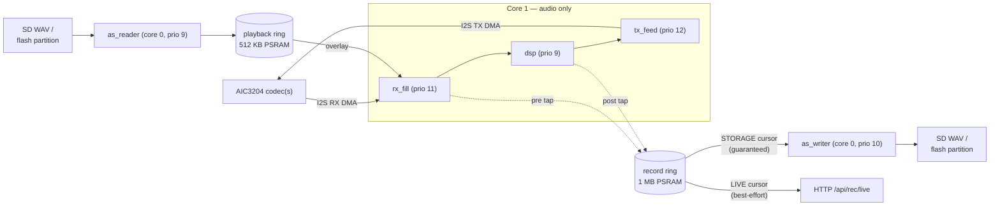

<!-- SPDX-License-Identifier: MIT -->
<!-- Copyright (c) 2026 SigPro Labs, LLC -->

# RadioSonic Firmware Architecture

One ESP32-S3, two cores, one rule: **core 1 runs audio and nothing else.**
`app_main` ([main/radiosonic_main.c](../main/radiosonic_main.c)) is the
composition root — it brings the system up in dependency order (SPI/codec
probe → block geometry → storage → I2S → DSP → settings → WiFi/web → tasks →
console) and owns the real-time plumbing: tasks, queues, ping-pong buffers,
and the I2S channels.

## Data path

Audio moves through three core-1 tasks connected by queues that carry only a
buffer index — the ping-pong buffers themselves are four static 4 KB internal
blocks, handed off lock-free (a consumer must finish its block within two
block periods; violations show as garbled audio and rx "late audio block"
warnings, never crashes). Block geometry (`g_geom`, [main/common.h](../main/common.h))
varies frames × channels × slot width at runtime — std stereo 512×2×32-bit,
TDM up to 6 channels — but the block byte size never exceeds PP_BYTES (4096),
so the buffers never grow.



- **Recorder** ([main/audio/audio_store.c](../main/audio/audio_store.c)): one
  producer (the audio hot path, pre- or post-DSP tap), two independent cursors
  on a 1 MB PSRAM ring. STORAGE is drained continuously by the writer task
  through internal DMA staging (SD hates PSRAM-sourced writes); it is never
  overwritten unstored — the producer drops newest instead. LIVE is
  best-effort: lag too far and the producer snaps it forward.
- **Playback**: a reader task prefills a 512 KB PSRAM ring from SD or flash;
  `rx_fill` overlays it onto the I2S-clocked buffer. The hot paths on both
  sides are PSRAM memcpy only — no SD/flash I/O ever happens on core 1.

## Tasks, cores, priorities

From the task map in `app_main` step 5 (radiosonic_main.c):

| Core | Task | Prio | Notes |
|---|---|---|---|
| 1 | tx_feed | 12 | highest — codec output must never starve |
| 1 | rx_fill | 11 | paces the whole pipeline (I2S is the clock) |
| 1 | dsp | 9 | the effect math |
| 0 | wifi driver | 23 | IDF-owned |
| 0 | wedge_watch | 20 | hang detector → abort → coredump |
| 0 | lwIP tcpip | 18 | pinned via sdkconfig |
| 0 | TinyUSB device | 12 | CDC console + xfer transport |
| 0 | as_writer | 10 | record-ring → SD/flash |
| 0 | as_reader | 9 | SD/flash → playback ring |
| 0 | rec_stop / rec_live / httpd / restart / console | 5 | |
| 0 | ctrl_btn | 4 | buttons + pot poll (20 ms) |
| 0 | wifi_init | 3 | |
| 0 | in_guard | 2 | stuck-input guard (input_guard.c) |
| 0 | led / timer-svc | 1 | heartbeat + status strip |

**Floating tasks are forbidden.** An unpinned task can migrate onto core 1 and
steal audio headroom. Every new task is `xTaskCreatePinnedToCore(…, 0)` and
gets a row in the radiosonic_main.c map.

A task that an effect owns
([ADDING_EFFECTS.md](ADDING_EFFECTS.md#effects-that-own-a-task)) follows the
same rule. Its stack may be in PSRAM, created with
`xTaskCreatePinnedToCoreWithCaps(…, 0, MALLOC_CAP_SPIRAM | MALLOC_CAP_8BIT)`,
if the task never calls flash or NVS functions: they turn off the cache, and
PSRAM with it, while they run. A PSRAM stack costs internal RAM only for the
task control block, so it needs no ledger row.

## Control plane

CLI console, web UI/HTTP API, front-panel buttons (addressed positionally
`btn1..btn5` — the silkscreen was renumbered between revs), the analog pot,
and the NVS settings store all converge on one shared state struct,
`g_state` (common.h). Writing rules ([main/audio/dsp_effects.h](../main/audio/dsp_effects.h)):
single aligned scalars are atomic on Xtensa and need no lock; multi-field
configs (filter coefficient sets, the channel effect's delay paths) are published under
`dsp_cfg_lock()`, and the DSP task snapshots a coherent copy once per block.
Each module registers its own CLI commands with `esp_console`, so a feature's
verbs live next to its implementation.

## Internal RAM budget

Internal SRAM is the scarce resource on this board (PSRAM is plentiful — big
buffers go there). Task stacks, DMA buffers, and TinyUSB FIFOs **must** be
internal (one exception: a task that never calls flash or NVS functions may
keep its stack in PSRAM, see [Tasks, cores, priorities](#tasks-cores-priorities)),
so every KB here is contended. This table is the ledger of deliberate
internal allocations ≥ 4 KB. **Any change to one of these — or any new internal
allocation ≥ 4 KB — updates this table and gets verified against the boot
checkpoints below in the same commit.**

| Allocation | Size | Where | Why internal |
|---|---|---|---|
| CDC TX FIFO | 8 KB (was 16 KB until 2026-07-08) | `sdkconfig.defaults` `CONFIG_TINYUSB_CDC_TX_BUFSIZE` | TinyUSB touches it from ISR context; ceiling ≥ ~800 KB/s even at a drifted 100 Hz tick (≥ 4 KB floor enforced by `_Static_assert` in `serial_xfer.c`) |
| httpd task stack | 8 KB (was 16 KB until 2026-09-06) | `web_server.c` `HTTPD_STACK_SIZE` | Task stacks must be internal; sized for SD download handlers. **Allocated BEFORE `esp_wifi_init()` (wifi_manager.c) — see the ordering note below.** Start is still gated on largest-free-block. Cut against this file's own instrumentation: after a full SD download `status` reports 5,264 B of 8,192 still unused (peak ≈ 2.9 KB; it read 4,032 B peak at the 16 KB size), so 8 KB keeps ~2× margin. Re-read that number after adding any deep handler. |
| Audio ping-pong buffers | 16 KB (4×4 KB, static .bss) | `radiosonic_main.c` `g_rx/tx_ping/pong` | I2S DMA source/sink. **Invariant: block byte size ≤ PP_BYTES (4096) in every mode** — TDM varies frames×channels×width inside the same 4 KB (`g_geom`, common.h), so these never grow |
| Recorder DMA staging | 16 KB (was 32 KB until 2026-07-08; adaptive, may shrink to 4 KB) | `audio_store.c` `REC_DMA_BYTES` | SD writes from PSRAM hit the ~270 KB/s bounce path; DMA-capable staging writes ≫ the 384 KB/s requirement (TDM worst case 768 KB/s — still ≪ FAT-DMA 1.1 MB/s) |
| I2S DMA descriptors/buffers | ≤ ~23 KB all modes | IDF defaults (std); TDM scales `dma_frame_num` 240→120/160 in `radiosonic_main.c` | Hardware DMA. Bytes/descriptor held at the std baseline (1920 B) so TDM adds nothing here |
| App task stacks | ~59 KB total | see task map in `radiosonic_main.c` | wifi 8K, cli 8K, audio 3×4K, writer/reader 2×4K, sys_evt 4.5K, in_guard 4K (added 2026-09-28; its deepest path, a recovery with float logging, measured 3,140 B used, and 3 KB would overflow), wedge 2.5K, TinyUSB ~4K, … |
| WiFi driver pools | ~50-60 KB while enabled | IDF, allocated at `esp_wifi_start()` | Driver requirement — this is the boot-time heap **peak** |

PSRAM allocations (deliberately *not* internal): 1 MB record ring, 512 KB
playback ring, DSP delay lines; with expansion codecs (TDM), per-pair DSP
state for pairs 1-2 (~17 KB + a 576 KB channel-delay buffer each,
split per effect since the framework refactor: channel delay rings in
`main/audio/channel_fx.c` (`channel_fx_init()`), and any other effect
allocates its own;
pair-0 state stays internal .bss as before).

### How the budget is enforced (measure, don't estimate)

- Boot logs one `heap:` line per phase — `storage-up`, `audio-up`,
  `app_main-done`, `usb-up`, `wifi-up`, `httpd-up` — with internal free /
  largest free block / min-ever. `wifi-up` is the peak that matters.
- `status` (CLI) prints the same numbers on demand, including the lifetime
  low-water mark.
- **Constraint: largest free internal block at `wifi-up` must stay ≥ 32 KB**
  (2× the httpd stack, margin for fragmentation variance). If a change eats
  into that, it doesn't ship on size alone — trim or move something first.
- Known failure mode when violated: `httpd_start` fails at its (silent) task
  creation step → `E web: httpd_start attempt …` with heap stats, retried 5×
  on a 3 s timer (web_server.c).
- **IDF gotcha (v5.5.0 through v5.5.4): the ESP_ERR_HTTPD_TASK path leaks the
  bound port-80 listen socket** — every subsequent httpd_start fails `error in
  listen (112)` (EADDRINUSE) until reboot. Retrying httpd_start cannot recover
  from a task-create failure; the attempt must be *gated* on
  `heap_caps_get_largest_free_block(MALLOC_CAP_INTERNAL)` ≥ stack + margin so
  the leaky path is never entered. v5.5.5 closes the sockets on that path. Keep
  the gate anyway: the firmware still builds on older v5.5.x.
- The dated hardware measurements behind these numbers, including the history
  of each ledger row, are in the
  [internal RAM measurement log](#internal-ram-measurement-log) at the end of
  this document. Add new measurements there.

## Resource-change checklist

**The umbrella rule — cross-module impact.** Modules in this firmware couple
through shared resources that never show up in a diff: internal heap, the
core-0 priority ladder, core-1 audio headroom, flash-cache suspensions (which
stall BOTH cores), console/CDC TX bandwidth, the shared SPI bus (up to 3
codecs on CS 9/48/47 — plus SD on Rev 1), the shared I2S/TDM bus (slot map +
MCLK: 12.288 MHz std, 24.576 MHz TDM — every codec PLL references it), the
USB PHY, the ~500 mA USB supply budget (each expansion codec adds MICBIAS +
ADC draw), PSRAM bandwidth, and interrupt/DMA slots. A change that is locally
correct can break a module it never mentions. Before committing any change that consumes a resource: name
the shared resources it touches, name the *other* modules contending for each,
and verify at system level (boot `heap:` lines, `status`, rx-overrun /
late-block counters) — not just the changed module's own behavior.

Specific lessons already paid for — check the diff against these:

1. **Internal RAM**: new/changed allocation ≥ 4 KB → update the ledger above +
   compare `heap:` boot lines before/after on hardware.
2. **Tasks**: `xTaskCreatePinnedToCore(…, 0)` only — core 1 is audio-only
   (tx 12 / rx 11 / dsp 9). An unpinned task can migrate onto core 1 and
   starve the pipeline. Add new tasks to the task map in `radiosonic_main.c`.
   A PSRAM stack (`xTaskCreatePinnedToCoreWithCaps`, still core 0) is only for
   a task that never calls flash or NVS functions.
3. **sdkconfig**: it's untracked — mirror every project-critical change into
   `sdkconfig.defaults` (+ a drift guard where possible, e.g. the CDC FIFO
   `_Static_assert`).
4. **Console output**: never printf bulk data or post-transfer status lines —
   the console path drops bytes under TX pressure; use the flow-controlled
   CDC path (`serial_xfer.c`). Bit us twice.
5. **Blocking in hot paths**: no SD/flash I/O, no locks held across memcpy in
   the audio tasks; flash writes suspend the cache and stall both cores
   (issue #12 splice tripwires).
6. **Claimed-fixed vs verified**: hardware-affecting changes are UNTESTED until
   run on the board — say so in the commit message (project convention).

## Module map

| File | One line |
|---|---|
| `main/radiosonic_main.c` | composition root: boot order, audio tasks, ping-pong buffers, I2S |
| `main/common.h` | shared data contract: constants, `g_geom`, `g_state` |
| `main/audio_pipeline.h` | pipeline control API (suspend/resume, heap checkpoint, overrun counter) |
| `main/audio/audio_codec.c/.h` | AIC3204 SPI register driver: probe, init, gains, TDM slots, sleep/wake |
| `main/audio/input_guard.c/.h` | stuck-input guard task (`in_guard`): watches LINE IN for the stuck-input signature and runs the codec recovery |
| `main/audio/audio_dsp.c/.h` | DSP framework: Q31/Q15↔float, sample loop, clipping, load meter, TDM mixdown |
| `main/audio/dsp_effects.c/.h` | effect FRAMEWORK: registry + hooks, config locking, per-pair selection, meter, and bypass (the one built-in entry). `dsp_effects_init()` registers channel, then calls `rs_user_effects_init()` |
| `main/audio/channel_fx.c/.h` | the channel multi-tap delay, a registered effect laid out like a sandbox one (record `g_fx_channel`, init `channel_fx_init()`); the worked example in docs/ADDING_EFFECTS.md |
| `main/audio/channel_panel.html` | the channel effect's web card (its `web_panel`), embedded by main/CMakeLists.txt; the worked example of an effect panel |
| `components/rs_student_fx/` | the student sandbox: effects outside the core, registered via `rs_user_effects_init()` |
| `main/audio/audio_store.c/.h` | recorder + playback: rings, cursors, writer/reader tasks, SD + flash backends |
| `main/audio/wav_util.h` | the canonical 44-byte WAV header |
| `main/board/hal.h` | HAL API + Kconfig revision selector |
| `main/board/hal_rev1.h/.c` | Rev 1 prototype pins + implementation (SDSPI, no panel controls) |
| `main/board/hal_rev2.h/.c` | Rev 2 pins + the shared implementation for Rev 2/3/A |
| `main/board/hal_rev3.h` | Rev 3 (DVT) pin deltas over Rev 2 |
| `main/board/hal_reva.h` | production Rev A pins (Rev 3 pinout) + its board-level changes |
| `main/board/rgb_leds.c/.h` | SK6805 LED strip driver (RMT) |
| `main/board/sd_storage.c/.h` | SD mount + `sd_*` CLI commands |
| `main/board/power_sleep.c/.h` | light-sleep enter/wake sequencing |
| `main/ui/cli_console.c/.h` | TinyUSB CDC console (esp_console REPL) + core commands |
| `main/ui/led_status.c/.h` | what the 4-LED strip shows: input, bypass, the Mode LED (the current effect's `led_rgb`), sub-mode, and the meter needle |
| `main/ui/web_server.c/.h` | HTTP control panel and API, including the generic effect endpoints (`/api/modes`, `/api/fx/<name>`, `/api/fx/<name>/panel`) |
| `main/ui/wifi_manager.c/.h` | WiFi lifecycle: STA credentials with softAP fallback, the `wifi` command, sleep suspend/resume; starts and stops web_server's httpd |
| `main/ui/web_page.html` | the control page, embedded at build; holds no effect code; from `/api/modes` it builds a card for each effect that has a `web_panel` (its own fragment) or a text config (the generic card), and effects with neither, such as bypass, get none |
| `main/ui/control_buttons.c/.h` | front-panel buttons: shift layer, feature/sub-mode, gains, sleep hold |
| `main/ui/control_pot.c/.h` | analog pot (Rev 3 / Rev A), off by default: `pot volume` drives the DAC volume, `pot fx` the current effect's `pot_set`; soft takeover through a dead-band |
| `main/ui/serial_xfer.c/.h` | flow-controlled USB file transfer (`xfer`), spec in docs/SERIAL_XFER.md |
| `main/ui/settings_store.c/.h` | NVS snapshot of everything button/CLI-changeable |

## Dependency direction

```
board  ←  audio  ←  ui        (arrows = "may be included by")
```

`main/` composes all three; nothing includes back into it (modules reach the
pipeline only through `audio_pipeline.h` and `common.h`). Documented
exceptions: `power_sleep.c` and `sd_storage.c` sit in `board/` as
board-adjacent *services* and call upward (sleep orchestrates the pipeline,
codec, store, and web server; SD mount notifies the audio store), and every
module registers its own CLI commands rather than routing them through `ui/`.

## Symbol prefix → module

| Prefix | Module |
|---|---|
| `audio_store_*` | main/audio/audio_store.c |
| `codec_*` | main/audio/audio_codec.c |
| `dsp_*` | main/audio/audio_dsp.c + dsp_effects.c (framework) |
| `fx_*` (effect-internal) | effect sources in components/rs_student_fx/ + main/audio/channel_fx.c |
| `hal_*` | main/board/hal_rev1.c or hal_rev2.c (Kconfig-selected) |
| `rgb_leds_*` | main/board/rgb_leds.c |
| `power_sleep_*` | main/board/power_sleep.c |
| `web_server_*` | main/ui/web_server.c |
| `xfer` (CLI), `register_serial_xfer_cmd` | main/ui/serial_xfer.c |
| `settings_*` | main/ui/settings_store.c |
| `control_pot_*` | main/ui/control_pot.c |
| `control_buttons_*` | main/ui/control_buttons.c |

## Internal RAM measurement log

Dated measurements behind the [internal RAM budget](#internal-ram-budget),
oldest first. Unless an entry says otherwise, figures are the boot `heap:`
lines and `status` output described there.

- **Measured 2026-07-08, before trims (CDC FIFO 16 KB + staging 32 KB):
  CONSTRAINT VIOLATED** — `wifi-up: largest=12288` → httpd_start failed
  `ESP_ERR_HTTPD_TASK` (12,288 < 16,384 stack); web UI dead every boot.
- **Baseline after trims (CDC FIFO 8 KB, staging 16 KB, same day):**
  `wifi-up: internal free=34571 largest=29696` → httpd up first try;
  steady state with httpd running: 21 KB free, largest 13 KB, min-ever 13 KB.
  Note: 29,696 is still slightly under the 32 KB target — the gate covers the
  gap, but the next internal-RAM consumer must reclaim elsewhere first
  (candidates: WiFi static RX buffer count, `CONFIG_SPIRAM_TRY_ALLOCATE_WIFI_LWIP`).
- **2026-09-06 — the gate had become unpassable in EVERY mode, and the fix was
  ordering, not size.** Measured on current main (std I2S, single codec):
  `wifi-up largest=8192` in BOTH AP and STA, so httpd was gated off all 5
  attempts and the web UI was dead whenever WiFi was enabled — the 29,696
  figure above had silently stopped holding. A/B against committed 2c42c09
  measured the same 8192, so this predated the effect-framework work.
  Two changes fixed it, both verified on the Rev 2 bench:
  1. **httpd now starts before `esp_wifi_init()`** (wifi_manager.c). Nothing in
     `httpd_start` needs the radio — lwIP is already up and INADDR_ANY:80 binds
     with no netif — so it takes its 16 KB block while the heap is still whole
     instead of competing with WiFi's ~64 KB of pools and their fragments.
     NOTE this is NOT the "reserve at the top of app_main" idea that boot-looped
     (that starved SD/I2S/USB init); here every other boot allocation is done.
  2. **A course module's 20 KB benchmark scratch left permanent `.bss`**,
     lowering the heap floor by the same amount.
  Result: `pre-wifi free=99935 largest=59392` → `httpd-up free=79507
  largest=38912` (server ready) → `wifi-up free=10991 largest=6144`, STA
  associated, web UI reachable and every `/api/fx/<name>` endpoint verified.
  Steady state with httpd + STA up: 18 KB free, largest 7 KB, min-ever 6 KB —
  workable but tighter than the old 21/13/13, so the next internal consumer
  still has to reclaim first.
- **HTTP SD download truncation: FIXED 2026-09-06.** It was the "throughput"
  tuning causing it — `LWIP_TCP_SND_BUF/WND_DEFAULT=65535` (11.4× the IDF
  default) let ~64 KB of TCP segments per socket allocate internal-first under
  `SPIRAM_MALLOC_ALWAYSINTERNAL=16384`, starving a heap that only had ~18 KB
  free. Trimmed to 11680 (8×MSS) + `SPIRAM_TRY_ALLOCATE_WIFI_LWIP=y` (a boot
  no-op, as measured in July, but it targets exactly the lwIP *runtime* churn
  that a boot-heap measurement cannot see) + the httpd stack cut to 8 KB.
  Measured before: 1,409,024 of 2,304,044 B then stall. After: **2,304,044 B
  complete, RIFF size field matches, 78 KB/s, 28.8 s**, and steady state went
  from 18 KB free / 7 KB largest / min-ever 6 KB to **36 / 22 / min-ever 26 KB**
  — the min-ever is the tell: the transfer no longer drives the heap to the
  floor.
- **WiFi modem sleep was the real throughput limit — `esp_wifi_set_ps(NONE)`,
  2026-09-06.** With the window trimmed, downloads ran at only 78 KB/s. Cause
  was NOT the window: IDF defaults to `WIFI_PS_MIN_MODEM`, which parks the
  radio between DTIM beacons and put the board **218 ms** away on a LAN whose
  own gateway answers in 3 ms (control-pinged both). TCP throughput is
  window/RTT, so that latency — not the buffer size — set the ceiling.
  Disabling power save in `apply_wifi_txpow()` (it resets on every
  `esp_wifi_start()`, same as the TX-power cap): **RTT 218 → 32 ms avg / 6 ms
  floor, download 78.1 → 521.5 KB/s complete**, which is the same ballpark as
  the USB `xfer` path (515 KB/s) — i.e. the bottleneck is now SD-read/handler
  work, not the network. Costs ~30-50 mA of always-on radio against the
  ~500 mA USB budget; light sleep is unaffected (suspend stops WiFi first).
  Audio load and rx-overrun/drop counters unchanged across the transfer.
- **2026-09-28: LINE IN fix added the 4 KB `in_guard` task (stuck-input guard).**
  Measured on Rev A SN 0234 (std I2S, AP mode): `pre-wifi free=94331
  largest=53248` → `httpd-up 82591/40960` → `wifi-up 19383/14336`, all at or
  above the 2026-09-06 figures. Steady state: 27 KB free, 15 KB largest,
  min-ever 19 KB. The build before this read 32/20/24, but that was after 12 h
  of uptime, so the two aren't a strict A/B. The guard's per-block input
  statistics run in rx_fill on core 1. They sample every 4th frame (~0.3% of
  the block budget). The `status` Load meter in bypass read 256 µs both before
  and after.
- **2026-10-05: ESP-IDF moved from a pre-release v5.5 snapshot (cf8dad0746,
  reported as 5.5.0) to v5.5.5. Shipped with `ESP_WIFI_RX_IRAM_OPT=n`
  (sdkconfig.defaults section 11), because stock v5.5.5 halved the largest
  free block; WiFi throughput with it is pending Dan's test on a clean
  link.** A map-file diff of identical source shows static internal RAM up 4,932 B
  (DIRAM 194,207 to 199,139: IRAM code +3,096, .data +1,756, .bss +80), all
  inside IDF and spread thin (WiFi/PHY blobs, SPI-master fixes, flash/PSRAM
  helpers). Measured on Rev A SN 0234 (std I2S, AP mode, same source, two
  boots each, identical):

  | Build | pre-wifi free/largest | httpd-up | wifi-up | steady (status) |
  |---|---|---|---|---|
  | old snapshot | 93,479 / 53,248 | 81,739 / 40,960 | 18,519 / 14,336 | 26 / 14 KB |
  | v5.5.5 | 88,587 / 47,104 | 76,759 / 36,864 | 13,623 / 7,680 | 21 / 7 KB |
  | v5.5.5 + `ESP_WIFI_RX_IRAM_OPT=n` | 99,083 / 57,344 | 87,255 / 47,104 | 24,119 / 15,872 | 31 / 16 KB |

  The halved largest block is visible in use: with WiFi up, `sd_diag` gets
  only a 4 KB DMA buffer and its duplex writer cannot start (write 0 KB/s).
  DSP load, benchmark timing (WiFi off; identical to ±3 µs), USB `xfer speed`,
  recording and playback were unchanged; `xfer getraw` rose 433 to 472 KB/s.
  RX_IRAM_OPT off trades WiFi RX speed for 10.3 KB of IRAM. STA mode on the
  bench network shows the same pattern at wifi-up: 22,483 / 15,872 (old),
  17,283 / 9,216 (v5.5.5), 27,775 / 19,456 (RX_IRAM_OPT off). Its WiFi
  throughput cost is still unresolved: that link swung from 90% packet loss
  to clean within minutes on the old build too, which swamps any firmware
  difference. All builds passed upload read-back checks and kept the httpd
  stack at ~4.2 KB unused. **min-ever is not comparable across this
  boundary:** v5.5.5 stopped counting heaps registered after startup in
  `heap_caps_get_minimum_free_size` (41ea1c562f), so it reads lower for the
  same heap. Compare free and largest only. Two v5.5.5 allocator changes
  also reach this budget:
  1. Plain `malloc()` can now draw down the 32 KB internal DMA reserve
     (`SPIRAM_MALLOC_RESERVE_INTERNAL`) before it falls back to PSRAM
     (esp-idf #18938, a confirmed regression, open as of this date). With our
     `ALWAYSINTERNAL=16384`, the 4-16 KB transfer buffers in web_server.c,
     serial_xfer.c and `sd_diag` take reserve memory once the ordinary
     internal heap is full, where they used to spill to PSRAM. Espressif's
     fix is `ALWAYSINTERNAL=0` (PSRAM first). Not applied yet: it moves those
     buffers onto the SD bounce path, so it needs a throughput measurement.
  2. SD transfers to or from PSRAM buffers would allocate an 8 KB internal DMA
     bounce buffer each. Pinned back to the old single-block path in
     hal_rev1.c / hal_rev2.c. Measured with the IDF default (16 blocks): the
     `sd_diag` PSRAM-source fwrite rose from ~470 to 1,700-2,600 KB/s with no
     errors at a 7 KB largest block (the allocation halves until it fits).
