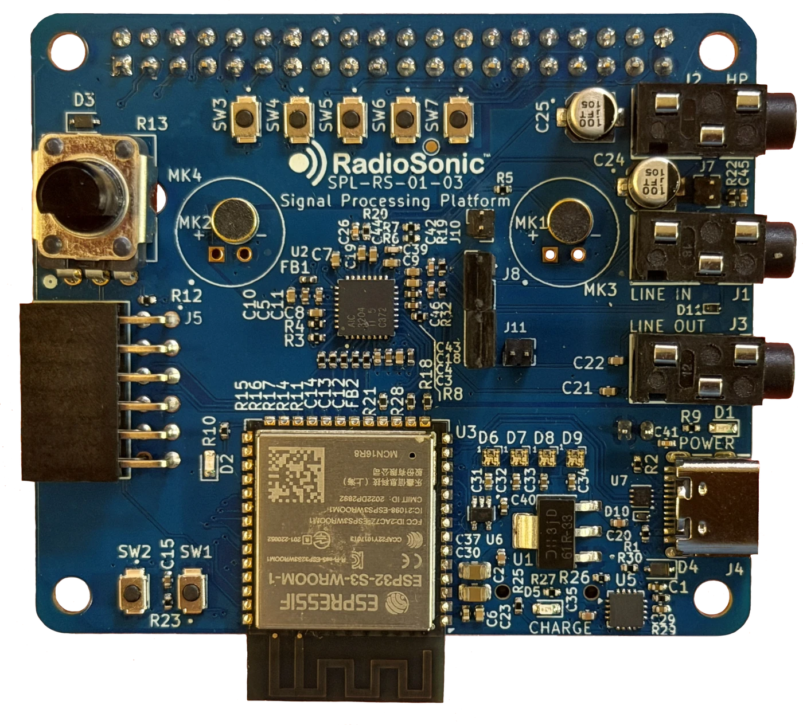

<!-- SPDX-License-Identifier: MIT -->
<!-- Copyright (c) 2026 SigPro Labs, LLC -->
<div class="cover" align="center">
<p class="cover-name">RadioSonic™</p>
<p class="cover-title">Firmware CLI Manual</p>
<p class="cover-edition">Core Edition · Firmware 0.9.1</p>

<p class="cover-by">SigPro Labs, LLC</p>
<p class="cover-meta">October 2026<br>Copyright © 2026 SigPro Labs, LLC. Licensed under the MIT License.<br>RadioSonic and SigPro Labs are trademarks of SigPro Labs, LLC.</p>
</div>

# RadioSonic™ Firmware CLI Manual (Core Edition)

Copyright © 2026 SigPro Labs, LLC. This manual is licensed under the MIT License.
RadioSonic and SigPro Labs are trademarks of SigPro Labs, LLC.

This manual covers the core firmware: the pass-through mode (`bypass`) and the built-in
multi-tap delay (`channel`). Add-on effects come with their own documentation.
[Add-on effects](#add-on-effects) explains how they fit into the controls described here.
To build and flash the firmware, see [`docs/GETTING_STARTED.md`](GETTING_STARTED.md).

## Contents

- [Connecting to the console](#connecting-to-the-console)
- [Basic commands](#basic-commands)
- [DSP mode](#dsp-mode)
- [Input](#input)
- [Channel delay](#channel-delay)
- [Recording](#recording)
- [Playback](#playback)
- [Web control panel](#web-control-panel)
- [Front-panel buttons](#front-panel-buttons)
- [Analog pot](#analog-pot)
- [Saving settings](#saving-settings)
- [Sleep mode](#sleep-mode)
- [SD card](#sd-card)
- [Expansion codecs](#expansion-codecs)
- [Quick reference](#quick-reference)
- [Specifications](#specifications)
- [Appendix A: Scripting interfaces](#appendix-a-scripting-interfaces)
- [Appendix B: Diagnostic commands](#appendix-b-diagnostic-commands)

<div class="page-break"></div>

## Connecting to the console

Connect the board to a computer with a USB cable and open its serial port in a terminal
program: PuTTY on Windows, or `screen` on macOS and Linux. Set flow control to None. Any
baud rate works.

The board appears as two different serial ports in turn. For the first few seconds
after power-up it is the ESP32-S3's USB-Serial-JTAG port, which is used for flashing.
The firmware then hands the USB connection to the console and the board reappears as a
new port. Open that second port. On Windows you will hear one USB connect sound followed
by one disconnect sound during this switch. That is normal.

When the terminal connects, the board prints a banner and the `dsp>` prompt:

```
RadioSonic by SigPro Labs, LLC
Version <version>  [last reset: POWERON]
dsp>
```

The reason in brackets is explained in
[Restart reasons and crash dumps](#restart-reasons-and-crash-dumps).

## Basic commands

| Command | Description |
|---------|-------------|
| `help` | Lists every command with a one-line description |
| `status` | Shows the input, gains, knob, codecs, input guard, DSP mode and the active effect's settings, processing load, SD card, memory and WiFi state |
| `ver` | Shows the firmware version and the board revision the firmware was built for |
| `restart` | Restarts the board without changing any settings |
| `settings` | Saves and loads settings (see [Saving settings](#saving-settings)) |
| `sleep` | Puts the board to sleep (see [Sleep mode](#sleep-mode)) |

## DSP mode

```
mode <name>    Select an effect
mode           List the effects
```

| Mode | Description |
|------|-------------|
| `bypass` | Passes audio through unprocessed |
| `channel` | Multi-tap delay and reverb with separate left and right taps |

A mode change takes effect immediately. The board starts in `channel` unless a saved
power-on default selects another mode (see [Saving settings](#saving-settings)).

`mode` with no argument lists every effect with its front-panel group and the color it
shows on LED 3, and marks the current effect with `*`:

```
Current mode: channel
Available modes: bypass channel

  name            group           LED      label
  bypass          -               off      Bypass
* channel         channel         #00FF00  Channel (L/R multi-tap)
```

If effects in two different groups share an LED color, the list flags them, because the
LEDs cannot tell those groups apart.

### Add-on effects

A firmware build can include add-on effects, such as a course's effect pack. An add-on
appears everywhere the built-in effects do:

- in the `mode` list and on the web UI's Mode buttons
- as a card on the web page, if it has settings or a card of its own
- as a console command named after the effect, if it has one (`help` lists it)
- in saved settings and in the HTTP API under `/api/fx/<name>`
- in the front-panel feature cycle, and on LED 3 in the color the effect sets
- on the knob through `pot fx`, if the effect supports it

To write your own, see [`docs/ADDING_EFFECTS.md`](ADDING_EFFECTS.md).

<div class="page-break"></div>

## Input

```
input <mic|diff>
```

| Option | Source |
|--------|--------|
| `mic`  | On-board microphones |
| `diff` | LINE IN jack |

LINE IN is a differential input, which rejects ground-loop hum from the source.

Selecting an input also sets a starting input gain: 20 dB for `mic` and 0 dB for `diff`.

```
gain <0-47>          Input gain in dB
gain in <0-47>       Same as gain <0-47>
gain out <-6..29>    Output gain in dB, applied to the headphone and line outputs
```

Gains are set in whole dB and take effect immediately. Buttons btn3 and btn4 step the
same values (see [Front-panel buttons](#front-panel-buttons)).

```
input mic
gain 30

input diff
gain 6

gain out -6
gain out 10
```

Unless a saved power-on default applies, the board starts with the microphones at 0 dB
input gain and 0 dB output gain. At power-up the inputs precharge for about 3 s before
audio starts. Switching between `mic` and `diff` is normally immediate. If the line input
locks up, the board detects it and reconnects the input, with a dropout of about 3 s (see
[Line-in guard](#line-in-guard)).

<div class="page-break"></div>

## Channel delay

Each side has up to 10 delay taps. The delay buffer holds 1.5 s of audio.

```
channel L|R <idx> <delay_ms> <weight>    Set one tap
channel L|R -n <count>                   Set the number of active taps
channel L|R -x                           Clear all taps, leaving one dry tap
channel pot [tap [lo_ms hi_ms]]          Choose the tap and range the knob sweeps
```

| Argument | Range | Meaning |
|----------|-------|---------|
| `L` or `R` | | Left or right side |
| `idx` | 0 to 9 | Tap number |
| `delay_ms` | 0 to 1000 | Delay in milliseconds; fractions are allowed |
| `weight` | −1.0 to +1.0 | Gain of the tap |
| `-n <count>` | 0 to 10 | Number of active taps |
| `-x` | | Resets the side to tap 0 at 0 ms with weight 1.0 |

Only taps 0 through count − 1 are processed. Setting a tap above the count raises the
count to include it, and `-n` sets the count directly, for example to silence the upper
taps without clearing them. Changes take effect immediately, and `status` lists every
tap with a nonzero weight. `channel pot` is described in [Analog pot](#analog-pot).

At power-up each side has a dry tap and three reflections: left 45, 120 and 200 ms,
right 48, 128 and 215 ms, at weights 0.5, 0.4 and 0.3.

A negative weight subtracts the delayed signal. With a short delay this makes a comb
filter:

```
channel L -x
channel L 0 0   1.0
channel L 1 1   -1.0
channel L -n 2
mode channel
```

#### Stereo echo

```
channel L -x
channel R -x
channel L 0 0 1.0
channel L 1 200 0.4
channel L -n 2
channel R 0 0 1.0
channel R 1 215 0.4
channel R -n 2
mode channel
```

#### Slapback

```
channel L -x
channel R -x
channel L 0 0 1.0
channel L 1 80 0.5
channel L -n 2
channel R 0 0 1.0
channel R 1 80 0.5
channel R -n 2
mode channel
```

#### Room reverb

```
channel L -x
channel R -x
channel L 0 0   1.00
channel L 1 17  0.60
channel L 2 43  0.40
channel L 3 89  0.25
channel L 4 150 0.15
channel L -n 5
channel R 0 0   1.00
channel R 1 19  0.60
channel R 2 47  0.40
channel R 3 97  0.25
channel R 4 163 0.15
channel R -n 5
mode channel
```

#### Ping-pong delay, 250 ms between repeats

```
channel L -x
channel R -x
channel L 0 0   1.00
channel L 1 500 0.35
channel L -n 2
channel R 0 0   1.00
channel R 1 250 0.50
channel R 2 750 0.25
channel R -n 3
mode channel
```

<div class="page-break"></div>

## Recording

The recorder captures 48 kHz, 32-bit stereo audio to the on-board flash or to the SD card.

```
rec start [flash|sd] [<path>]   Start recording (default backend: flash)
rec stop                        Stop and close the recording
rec status                      Recording state, backend, tap, length, buffer use
rec tap [pre|post]              Record the input (pre, the default) or the DSP output (post)
rec live stop                   End a live stream
```

The first word after `start` is always read as the backend, and any word other than `sd`
selects flash. `rec start /sdcard/take1.wav` therefore records to flash. Write
`rec start sd /sdcard/take1.wav`.

| Backend | Saves to | Maximum length |
|---------|----------|----------------|
| `flash` | The on-board flash | About 38 s |
| `sd` | A WAV file, `/sdcard/rec.wav` unless you give a path | Until the card is full |

`rec start flash` erases the flash first, which takes up to a few seconds. Live audio may
stutter during the erase. A flash recording cannot start while flash playback is running.

`rec tap` also selects what live streams carry. While a recording or live stream is
running, the tap stays fixed, and a change applies to the next start. With `rec tap pre`,
a recording made during playback captures the physical input; use `rec tap post` to
capture the processed playback.

Live streams start from the web page's **Live** button, `GET /api/rec/live` or
`xfer live` (see [Appendix A](#appendix-a-scripting-interfaces)). `rec live stop` ends
one from the console.

`rec stop` prints the length of the take. If it also prints an I2S RX overrun warning,
or `rec status` shows a `dropped` or `i2s_ovf` count above 0, the recording has gaps.

#### Record the microphones to flash and play the take through the delay

```
input mic
gain 20
rec start flash
# Record your take, then stop it:
rec stop

mode channel
play start flash
```

#### Record to a named file on the SD card and play it back dry

```
input diff
gain 10
rec start sd /sdcard/take1.wav
# Record your take, then stop it:
rec stop

mode bypass
play start sd /sdcard/take1.wav
```

<div class="page-break"></div>

## Playback

Playback replaces the live input, so the active effect processes the recording.

```
play start [flash|sd] [<path>] [--loop]   Start playback (default backend: flash)
play stop                                  Stop playback
play status                                Playback state, backend, buffer fill
```

As with `rec`, the first word after `start` is always read as the backend.
`play start /sdcard/take.wav` therefore plays the flash recording. Write
`play start sd /sdcard/take.wav`.

| Backend | Plays |
|---------|-------|
| `flash` | The last flash recording, or a sample uploaded through the web UI or `xfer put flash` |
| `sd` | A WAV file on the SD card. The default is `/sdcard/rec.wav`. |

Playback accepts only 48 kHz, 32-bit stereo audio. For any other format, `play start`
prints `play failed: ESP_ERR_NOT_SUPPORTED`; convert the file on a computer first.
Without `--loop`, playback stops at the end of the recording.

#### Loop the flash recording

```
play start flash --loop
play stop
```

#### Play a file through the delay

```
mode channel
play start sd /sdcard/rec.wav
```

#### Compare wet and dry on the same take

```
mode channel
play start sd /sdcard/take1.wav --loop
mode bypass
mode channel
play stop
```

#### Play a 48 kHz, 32-bit stereo WAV file uploaded through the web UI

```
play start sd /sdcard/guitar_riff.wav --loop
```

<div class="page-break"></div>

## Web control panel

The board serves a control panel over WiFi. It has most of the console's controls, plus
file upload and download.

### Connecting

At power-up the board joins the network saved with `wifi <ssid> <password>`. If no
network is saved, or after `wifi ap`, it starts its own access point.

| | Saved network | Access point |
|---|---|---|
| SSID | Your network | `RadioSonic` |
| Password | Your password | `radiosonic` |
| Address | Assigned by DHCP | `192.168.4.1` |

`wifi status` and `status` show the panel's address. Open the address in a browser. The
access point accepts up to four devices.

If the first connection attempt fails, the board retries after 0.5 s, 1 s and 2 s, then
starts the access point. It also starts the access point if no connection succeeds
within 12 s. If an established connection drops, the board retries after 0.5 s, 1 s and
2 s, then every 10 s until it reconnects.

### WiFi commands

```
wifi status               Show the WiFi mode and address
wifi <ssid> <password>    Save credentials and restart on that network
wifi ap                   Save access-point mode and restart
wifi off                  Turn WiFi off; the setting is saved
wifi on                   Turn WiFi on; the board restarts after 3 s
wifi power [dbm]          Show or set the transmit power limit, 2 to 13 dBm
```

Put an SSID or password that contains spaces in double quotes:
`wifi "Studio Network" mypassword`. Access-point mode stays selected until you save new
credentials.

WiFi settings are kept through firmware updates. Sleep turns WiFi off temporarily without
changing them.

Transmit power is limited to 8.5 dBm by default to keep the load on the USB supply down,
which is enough for use in the same room. For more range, use `wifi power 13`. If the
board resets during heavy WiFi traffic on a weak USB port, lower the limit. The limit is
set in 0.25 dB steps, is saved, and takes effect immediately.

### Panel controls

**Status** refreshes every 2 s and shows the mode, input, input and output gain, and SD
card state.

**Mode** has a button for each effect in the running firmware. **Input / Gain** works
like the `input` and `gain` commands, and choosing an input also sets its starting gain.

The page shows a card for each effect that has settings or a card of its own; `bypass`
has none. **Channel (Delay / Reverb)**
sets one tap at a time: choose the side (**Ch**), tap (**Idx**), delay (**ms**) and
weight (**w**), then click **Set tap**. **Clear ch** resets that side to one dry tap, and
**Count** sets the number of active taps. An add-on effect shows its own card, or a text
box of its settings lines with **Read**, **Load file** and **Apply** buttons.

**Record / Playback** records and plays on the flash or SD backend. Choose the **Source**;
for SD, type a path or pick a file with the folder button. Choose the **Tap**, then use
**Rec** and **Stop Rec**, or **Play** and **Stop** with **Loop** to repeat. **Live** opens
a live WAV stream of the selected tap in a new browser tab. **Listen in Browser** plays
the flash recording or the selected SD file on your computer.

**File Transfer** uploads files. To put a WAV file on the SD card, click **Choose File**
under "Upload to SD card", select the file, and click **Upload**. The log shows
`OK: <bytes> bytes -> /sdcard/<filename>` when the upload is complete, and the file keeps
its name. To load the flash sample, choose a raw PCM file (48 kHz, 32-bit stereo) under
"Flash sample" and click **Upload**. Play it with `play start flash`.

**SD Card Files** lists the files on the card. Click ↓ next to a file to download it, or
**Refresh** to update the list.

**WiFi** shows the current mode and address. **Save & Connect** saves new network
credentials and **Force AP mode** switches to the access point. The board restarts after
either one.

To control the board from a script, see
[Appendix A: Scripting interfaces](#appendix-a-scripting-interfaces).

<div class="page-break"></div>

## Front-panel buttons

On Rev 2, Rev 3 and Rev A boards, the BOOT button and the five top-row buttons control the
board. The top-row buttons are called btn1 to btn5 here, from left to right, because their
silkscreen labels differ between board revisions. The BOOT button is a shift key: hold it
while pressing a top-row button to get that button's second function.

| Button | Rev 2 label | Rev 3 and Rev A label | Press | With shift held |
|--------|-------------|-----------------------|-------|-----------------|
| btn1 | SW6 | SW3 | Next feature. Hold 1.75 s to sleep. | Next sub-mode |
| btn2 | SW3 | SW4 | Bypass on or off | Switch between line-in and mic |
| btn3 | SW7 | SW5 | Input gain +1 dB | Input gain −1 dB |
| btn4 | SW4 | SW6 | Output gain +1 dB | Output gain −1 dB |
| btn5 | SW5 | SW7 | Save settings. Hold 1.75 s to save as the power-on default. | Load saved settings |
| shift | SW2 | SW2 | Shift (BOOT) | |

btn1 steps through the effect features. The core firmware has one, Channel, and add-on
effects add more. Each feature remembers its last sub-mode, and shift+btn1 steps through
the sub-modes of the current feature. Channel has only one sub-mode.

btn2 turns bypass on and off. Turning bypass off returns to the selected feature.
Shift+btn2 switches the input and sets a starting gain: 0 dB for line-in, 20 dB for mic.

btn3 and btn4 step once per press. Held for 0.4 s, they repeat at about 7 steps per
second. Input gain runs from 0 to 47 dB and output gain from −6 to +29 dB.

### Status LEDs

The four LEDs show the current state, whether it was changed from the buttons, the
console or the web UI. LED 1 is on the left.

| LED | Shows | Colors |
|-----|-------|--------|
| 1 | Input | Yellow: mic. Cyan: line-in. |
| 2 | Bypass | White: bypass on. Off: processing. |
| 3 | Effect | The current effect's color: green for Channel. An add-on effect shows the color it sets, or dim white if it sets none. Off in bypass. |
| 4 | Sub-mode | Off for Channel and in bypass. For a feature with several sub-modes, green for the first and orange for the others. |

`mode` with no argument lists the LED 3 color of every effect (see [DSP mode](#dsp-mode)).

An add-on analyzer effect can use the LEDs as a meter. It shows an orange needle that
moves between LED 1 and LED 4, and a dim blue glow when it has no reading.

<div class="page-break"></div>

## Analog pot

Rev 3 and Rev A boards have a knob. You choose what it controls:

```
pot                Show the target, knob position and mapping
pot off            Knob controls nothing (the power-up setting)
pot volume         Knob sets the volume, -63.5 dB to 0 dB
pot fx             Knob controls the current effect
pot apply          Apply the knob position now
```

With `pot volume`, full counterclockwise is −63.5 dB, which is effectively silent, and
full clockwise is 0 dB. At full volume the output level is set by `gain out`. The volume
applies to the headphone and line outputs only, so recordings keep their level.

`pot fx` passes the knob to whichever effect is running, if that effect supports it. The
channel effect maps the knob to the delay of one tap, on both sides at once; each side
keeps its own weight. Choose the tap and range with `channel pot [tap [lo_ms hi_ms]]`;
the default is tap 1 over 0 to 250 ms. `pot` names the current effect's binding, or
reports that the effect has none.

The knob takes control only when you turn it. Selecting a target changes nothing, and a
value set another way (for example with a `channel` command or `settings load`) stays
until the knob moves. The value then jumps to the knob position.
`pot apply` applies the knob position immediately.

#### Use the knob as a delay-time control

```
mode channel
channel L -x
channel R -x
channel L 0 0 1.0
channel L 1 120 0.5
channel L -n 2
channel R 0 0 1.0
channel R 1 120 0.5
channel R -n 2
channel pot 1 5 400
pot fx
```

The knob now sweeps the echo from 5 ms to 400 ms. Between knob steps the delay glides,
so the echo bends in pitch as it moves, like a tape delay, and does not click. A turn
fast enough to move the delay more than 20 ms at once still jumps. The knob changes only
the tap's delay, so a tap with weight 0 sweeps silently: give it a weight first, as in
the example.

At every power-up the pot target returns to `off`, the volume to 0 dB, and the
`channel pot` setting to tap 1 over 0 to 250 ms. The delay times the knob sets are
ordinary tap settings, so `settings save` keeps them.

<div class="page-break"></div>

## Saving settings

`settings save` stores the DSP mode, the input, both gains, and the settings of every
effect, including add-ons.

There are two slots. `user` is a scratch preset, and `default` is applied at every
power-up.

```
settings save       Save to the user slot (btn5)
settings load       Load the user slot (shift+btn5)
settings default    Save as the power-on default (hold btn5)
settings show       Show what each slot holds
settings clear      Erase both slots
```

`settings load` uses the default slot if nothing has been saved to the user slot. If
neither slot has been saved, the board starts with its built-in settings. Settings saved
for an effect that is not in the running firmware are skipped.

WiFi credentials are stored by the `wifi` command and are not part of the settings.
Neither are the pot target, the `channel pot` setting or the expansion mix gains.

Settings cannot be saved or cleared during a recording or a live stream. Stop it, save,
and start again.

<div class="page-break"></div>

## Sleep mode

Sleep keeps all settings, and waking does not restart the board. Sleep is available on
Rev 2, Rev 3 and Rev A boards.

| Action | How |
|--------|-----|
| Enter sleep | Hold btn1 for about 1.75 s, or type `sleep` |
| Wake | Press btn1 |
| While asleep | The four status LEDs are off, and the heartbeat LED blinks briefly every 5 s |

Going to sleep stops any recording or playback and turns off WiFi and the LEDs. Audio
returns about 4.5 s after you press btn1, and WiFi reconnects if it was on.

If a computer is connected when the board goes to sleep, the console stays connected
throughout and responds as soon as the board wakes. Without a computer (on battery or a
charger), the board uses a deeper sleep that saves more power. If the console does not
appear when you later connect a computer, power-cycle the board.

## SD card

The board reads and writes microSD cards formatted as FAT. Recordings and uploads are
stored in `/sdcard`, and the web UI lists them for download.

```
sdtest           Check the card: identity, capacity, free space, and a short write and read test
sd_remount       Mount the card again after a failed mount
sd_format yes    Format the mounted card as FAT. Erases all data.
sd_diag          Measure the card's read and write speed
```

Run `sd_remount` if the card was not mounted at power-up, for example because it was
inserted later. If the card is already mounted, `sd_remount` only shows its details. If
the remount fails or a mounted card stops responding, power-cycle the board.

`sd_format yes` works only on a mounted card. It stops any recording or playback first.
On a large card it can take a while.

## Expansion codecs

Up to two expansion codecs can be added to the board. The firmware detects them at
power-up. Each one adds a stereo pair of microphone inputs, and the input gain applies to
them too.

The active effect processes each codec's pair separately, and the results are mixed into
the main board's outputs. Set a pair's level in the mix with `mixgain <pair> <gain>`,
where pair 0 is the main board and the gain runs from −8 to +8. Each gain starts at 1,
and `mixgain` alone shows the current values. The mix is clipped at full scale. Mix gains
return to their defaults at power-up.

With two expansion codecs, samples on the audio bus are 16-bit, and recordings are
16-bit too (see `settings slotwidth` in
[Appendix B](#appendix-b-diagnostic-commands)).

With `rec tap pre` the recorder writes every input channel. With `rec tap post` it writes
the stereo mix. Playback needs 32-bit stereo audio, so play multichannel or 16-bit
recordings on a computer. During playback the file replaces the main board's input pair,
and the expansion pairs keep their live microphones.

<div class="page-break"></div>

## Quick reference

| Task | Command |
|------|---------|
| Show the current state | `status` |
| List the effects | `mode` |
| Pass audio through unprocessed | `mode bypass` |
| Turn on the delay | `mode channel` |
| Set left tap 1 to 200 ms at weight 0.4 | `channel L 1 200 0.4` |
| Use taps 0 and 1 on the left | `channel L -n 2` |
| Reset the right side to one dry tap | `channel R -x` |
| Use the microphones (input gain 20 dB) | `input mic` |
| Use line-in (input gain 0 dB) | `input diff` |
| Set the output gain to +6 dB | `gain out 6` |
| Record to flash | `rec start flash`, then `rec stop` |
| Record to the SD card | `rec start sd /sdcard/take1.wav`, then `rec stop` |
| Play the flash recording | `play start flash` |
| Loop a file from the SD card | `play start sd /sdcard/take1.wav --loop` |
| Stop playback | `play stop` |
| Use the knob for volume | `pot volume` |
| Use the knob for delay time | `channel pot 1 5 400`, then `pot fx` |
| Keep the current setup at power-up | `settings default` |
| Show the WiFi address | `wifi status` |
| Sleep | `sleep`, or hold btn1 for 1.75 s |

## Specifications

| Parameter | Value |
|-----------|-------|
| Sample rate | 48 kHz |
| Sample format | 32-bit; 16-bit with two expansion codecs |
| Block size | 512 samples (10.67 ms); 256 samples (5.33 ms) with expansion codecs |
| Channel delay buffer | 1.5 s; longest tap delay 1000 ms |
| Codec | TI AIC3204; up to two more as expansion codecs |
| Line-in full scale | 0.75 Vrms, differential |
| Microphone bias | 2.075 V |
| SD card interface | Rev 1: SPI at 20 MHz. Rev 2, Rev 3 and Rev A: 4-bit SDMMC at 40 MHz. |
| Flash recording length | About 38 s |
| Board revision | Chosen at build time in menuconfig under RadioSonic Board Configuration. The default is Rev A. `ver` shows the revision of the running build. |

<div class="page-break"></div>

## Appendix A: Scripting interfaces

Programs can control the board in two ways: an HTTP API over WiFi, and a file transfer
and streaming protocol on the USB console port.

### HTTP API

Every web panel control is an HTTP request, so you can script the board with curl or any
HTTP client. POST bodies are form-encoded except where the table says otherwise.

```bash
# Select the channel effect
curl -d "mode=channel" http://<board-ip>/api/mode

# Set left tap 1 to 200 ms at weight 0.4
curl --data-binary "set L 1 200 0.4" http://<board-ip>/api/fx/channel

# Read the channel settings
curl http://<board-ip>/api/fx/channel

# Read the status as JSON
curl http://<board-ip>/api/status

# Upload a WAV file to the SD card
curl -X POST --data-binary @take1.wav "http://<board-ip>/api/upload/sd?name=take1.wav"
```

`GET /api/fx/<name>` returns an effect's settings as text, and `POST /api/fx/<name>`
changes them. Both use the effect's own text format, the same one `settings save` stores.
The channel effect accepts these lines, where `<side>` is `L` or `R`:

| Line | Effect |
|------|--------|
| `set <side> <idx> <delay_ms> <weight>` | Sets one tap |
| `count <side> <n>` | Sets the number of active taps |
| `clear <side>` | Resets a side to one dry tap |

<div class="page-break"></div>

### Endpoints

| Endpoint | Method | Body or query | Action |
|----------|--------|---------------|--------|
| `/api/status` | GET | | Status as JSON: mode, input, gains, SD card, recording and playback state, WiFi, and the analyzer meter |
| `/api/modes` | GET | | The effects as a JSON array: name, label, group, LED color, and whether each has text settings and its own web card |
| `/api/mode` | POST | `mode=<name>` | Set the DSP mode |
| `/api/input` | POST | `input=mic` or `input=diff` | Set the input and its starting gain |
| `/api/gain` | POST | `gain=<0-47>`, `gain_out=<-6..29>` (either or both) | Set the input and output gain |
| `/api/fx/<name>` | GET | | An effect's settings as text |
| `/api/fx/<name>` | POST | Settings lines, as plain text | Change an effect's settings |
| `/api/fx/<name>/panel` | GET | | An effect's web card as an HTML fragment, or 404 if it has none |
| `/api/rec/start` | POST | `backend=sd` or `flash`, `tap=pre` or `post`, `path=<file>`, all optional | Start recording. Defaults: flash, the current tap, `/sdcard/rec.wav`. |
| `/api/rec/stop` | POST | | Stop recording. A flash recording finishes in the background; poll `/api/status`. |
| `/api/rec/live` | GET | `?tap=pre` or `?tap=post` (optional) | Live WAV stream of the selected tap. It runs until you disconnect. One stream at a time. |
| `/api/play/start` | POST | `backend=sd` or `flash`, `path=<file>`, `loop=1`, all optional | Start playback |
| `/api/play/stop` | POST | | Stop playback |
| `/api/flash/wav` | GET | | Download the flash recording as a WAV file |
| `/api/files` | GET | | SD card files as a JSON array of `{name, size}` |
| `/api/download/sd` | GET | `?name=<file>` | Download a file from the SD card |
| `/api/upload/sd` | POST | `?name=<file>`, file as the body | Upload a file to the SD card. Without a name it is saved as `upload.bin`. |
| `/api/upload/flash` | POST | Raw PCM (48 kHz, 32-bit stereo) as the body | Replace the flash sample |
| `/api/wifi/sta` | POST | `ssid=<ssid>&pass=<password>` | Save network credentials and restart |
| `/api/wifi/ap` | POST | | Switch to access-point mode and restart |

SD file names cannot start with a dot or contain `/`, `\` or `"`.

<div class="page-break"></div>

### USB serial transfer

These commands use a binary protocol on the console port and are meant for scripts and
for browser apps that use Web Serial. [`docs/SERIAL_XFER.md`](SERIAL_XFER.md) specifies
the protocol.

```
xfer list                                    List the files on the SD card
xfer get <sd:NAME|flash>                     Download a file (base64 with a CRC-32 check)
xfer getraw <sd:NAME>                        Download a file as raw binary, about 900 KB/s
xfer put <sd:NAME|flash> <size> <crc32hex>   Upload a file
xfer live [pre|post]                         Stream live audio as raw binary
xfer speed [bytes]                           Measure USB throughput (default 1 MB)
```

`xfer live` sends a 44-byte WAV header followed by 48 kHz, 32-bit stereo PCM. It stops
when it receives any byte or when the port closes. Without an argument it streams the tap
selected with `rec tap`; with one, it also changes that setting. The stream runs at about
375 KB/s. Read it in large blocks; a host that processes it byte by byte can fall behind.

<div class="page-break"></div>

## Appendix B: Diagnostic commands

These commands are for troubleshooting and hardware bring-up. Normal operation does not
need them.

| Command | Purpose |
|---------|---------|
| `term` | Show the console's line-editing state |
| `term query` | Check whether the terminal answers a cursor-position request |
| `term smart`, `term dumb` | Switch the console's line-editing mode |
| `dump rx`, `dump tx` | Print every fourth sample of the last input or output audio buffer as CSV (`dump` alone prints the output) |
| `adc <gpio> [samples]` | Read a pin in mV (GPIO1 to GPIO20; other pins report their digital level). GPIO11 to GPIO20 cannot be read while WiFi is on. |
| `pot read` | Show the knob's raw and filtered readings |
| `rec stream`, `rec streamhex` | Send `/sdcard/rec.wav` to the console as binary or hex; for another file, `rec stream sd <path>` |
| `codec` | Show the detected codecs and the audio bus format |
| `codec check` | Compare the codec registers with the values the firmware wrote |
| `codec snapshot` | Show the codec registers as they were before boot initialized them |
| `codec dump [0 or 1]` | Dump codec register page 0 or 1 (both by default) |
| `codec rd <page> <reg>` | Read one codec register |
| `codec recover [ms]` | Precharge and reconnect the inputs |
| `codec guard [on, off or test]` | Show the line-in guard, turn it on or off, or force one recovery |
| `codec precharge [ms]` | Set the input precharge time (default 3000 ms; resets at power-up) |
| `codec reroute`, `adc`, `reinit` | Narrower recovery steps: rewrite the input routing, power-cycle the ADC, or reset and reinitialize the codec |
| `codec cm`, `probe`, `r63`, `offset`, `cs` | Hardware bring-up settings. Leave them at their defaults. |
| `settings slotwidth <auto, 16 or 32>` | Set the TDM slot width for expansion codecs. Takes effect after a restart and survives `settings clear`. |
| `bootloader` | Restart in download mode for flashing firmware |

`codec check`, `codec dump` and `codec rd` address the main codec. Add `exp1` or `exp2`
at the end to address an expansion codec.

### Line-in guard

The codec's line input can latch up and go silent if it is connected before its coupling
capacitors have charged. The firmware precharges each input for 3 s before connecting it.
In `diff` mode a guard also watches for the latched signature and runs a recovery, at
most once every 30 s. If two recoveries in a row leave the input unchanged, the guard
stands down until the next input change or `codec guard on`. `status` shows the guard
state and the number of recoveries.

### Restart reasons and crash dumps

The console banner shows why the board last restarted: `POWERON` for a normal power-up
(or a supply dropout, if unexpected), `BROWNOUT` for a supply dip, `SW` for a restart by
command, `PANIC` for a firmware crash, and `TASK_WDT`, `INT_WDT` or `WDT` for a watchdog
reset.

A crash saves a core dump to flash. To read it, type `bootloader`, close the serial port,
and run this command against the USB-Serial-JTAG port the board reappears as:

```
idf.py -p <PORT> coredump-info
```

Power-cycle the board to return to normal operation.

Copyright © 2026 SigPro Labs, LLC. This manual is licensed under the MIT License.
RadioSonic and SigPro Labs are trademarks of SigPro Labs, LLC.
